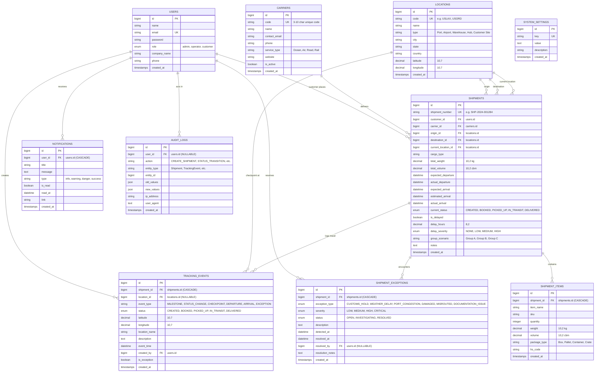

# CargoTrace - Entity Relationship Diagram & Data Dictionary

This document details the database architecture, table structures, relationships, cardinality, and design choices for the **CargoTrace Global Shipment Visibility Platform** (Web Programming 2 Final Project).

---

## 1. Entity-Relationship Diagram (ERD)

---

## 2. Data Dictionary

### Table: `users`
Stores system actors with role-based access control.
- `id`: Primary key, auto-incrementing 64-bit integer.
- `name`: Full name of user or primary representative.
- `email`: Unique login email address.
- `password`: Bcrypt / Argon2 hashed password.
- `role`: Role enum (`admin`, `operator`, `customer`).
- `company_name`: Associated corporate shipper name.
- `phone`: Contact telephone.

### Table: `carriers`
Stores integrated logistics transport carriers (e.g. FastShip, CargoPro, Maersk).
- `id`: Primary key.
- `code`: Unique uppercase carrier identifier code.
- `name`: Full legal company name.
- `service_type`: Primary transport mode (Ocean, Air, Intermodal).
- `is_active`: Operational status flag.

### Table: `locations`
Stores ports, airports, intermodal rail hubs, and regional warehouses.
- `id`: Primary key.
- `code`: UN/LOCODE or airport code (e.g. `USLAX`, `USORD`).
- `name`: Facility title.
- `type`: Category (`Port`, `Airport`, `Warehouse`, `Hub`).
- `latitude` / `longitude`: Decimal coordinates (precision 10, scale 7) used for Leaflet.js mapping and Open-Meteo meteorological queries.

### Table: `shipments`
Central aggregate entity managing life-cycle and scheduling.
- `shipment_number`: Unique business tracking code (e.g. `SHP-2024-001284`).
- `customer_id`: Foreign key to `users.id` representing owner.
- `carrier_id`: Assigned carrier.
- `origin_id` / `destination_id`: Routing terminals.
- `current_location_id`: Dynamic location pointer.
- `current_status`: Finite state machine (`CREATED`, `BOOKED`, `PICKED_UP`, `IN_TRANSIT`, `DELIVERED`).
- `is_delayed`: Computed boolean flag based on ETA vs SLA arrival.
- `delay_hours`: Numeric delay duration in hours.
- `delay_severity`: Classification (`LOW`, `MEDIUM`, `HIGH`, `NONE`).
- `group_scenario`: Identifier for unique course scenario (`Group A`, `Group B`, `Group C`).

### Table: `tracking_events`
Immutable historical checkpoints and waypoint telemetry.
- `shipment_id`: Target consignment.
- `event_time`: Verified chronological timestamp.
- `is_exception`: Flag distinguishing operational bottlenecks from standard milestones.

### Table: `shipment_exceptions`
Disruption records requiring manual or automated resolution.
- `exception_type`: Specific cause (`CUSTOMS_HOLD`, `WEATHER_DELAY`, `PORT_CONGESTION`, `DAMAGED`, `MISROUTED`, `DOCUMENTATION_ISSUE`).
- `severity`: Impact scale (`LOW`, `MEDIUM`, `HIGH`, `CRITICAL`).
- `status`: Incident workflow (`OPEN`, `INVESTIGATING`, `RESOLVED`).
- `detected_at` / `resolved_at`: Timestamps used to calculate Mean Time To Resolve (MTTR).

---

## 3. Cardinality & Design Decisions

1. **Why `Shipment -> TrackingEvents` is 1-to-Many:**
   A shipment moves across multiple spatial checkpoints (origin terminal, vessel departure, waterway corridor, customs gate, rail yard, and final consignee). Each checkpoint is recorded as an immutable row to preserve chronological auditability and route history.
2. **Why `Shipment -> ShipmentExceptions` is 1-to-Many:**
   A long-haul international shipment can encounter multiple distinct disruptions throughout its voyage (e.g. weather delay at sea followed later by documentation issues at customs).
3. **Database Driver Agnosticism:**
   All migrations, relationships, and queries are 100% compliant with both SQLite (for zero-setup dev & test) and MySQL 8+ (for production enterprise hosting).
